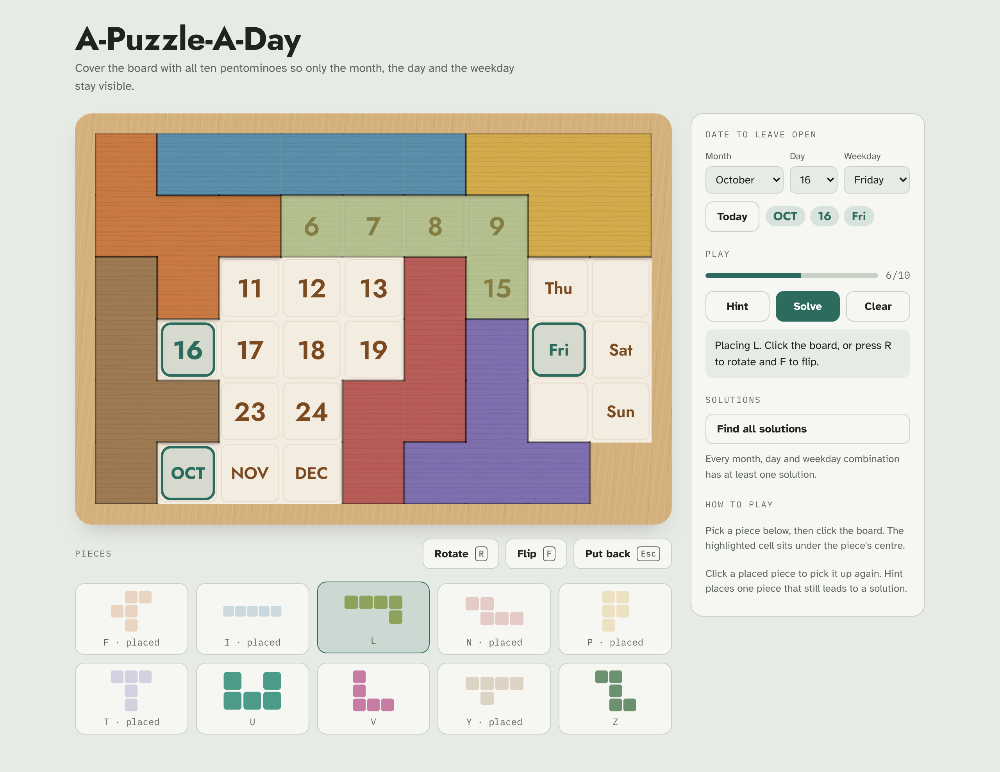
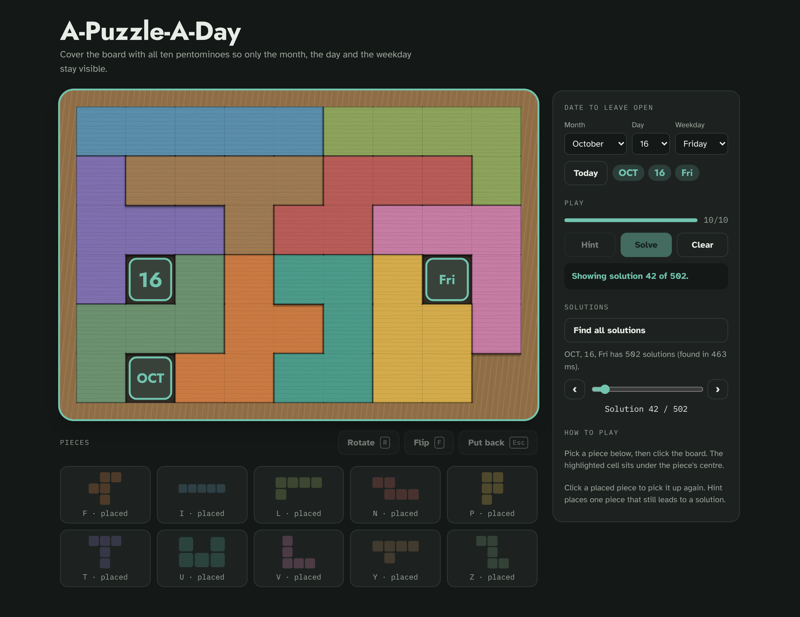
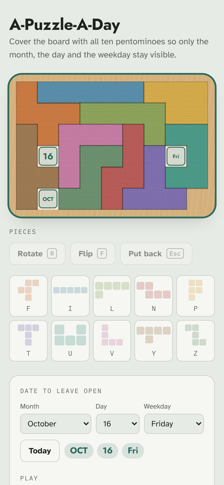

# A-Puzzle-A-Day

[](https://github.com/AddictionLord/a-puzzle-a-day/actions/workflows/ci.yml)

A game and solver for a wooden calendar puzzle. Ten pentominoes go on a 6 × 9 board so that exactly three
cells stay visible: today's **month**, **day** and **weekday**. There is a puzzle for every day of the year,
and every one of them has a solution.

The repository has two parts:

- a **browser game** in a single HTML file, with hints, an instant solver and a browser for every
  solution;
- a **Python package** with the same board model, a terminal game and an exact-cover solver.



## The puzzle

The layout follows a laser-cut wooden calendar puzzle:

| | 0 | 1 | 2 | 3 | 4 | 5 | 6 | 7 | 8 |
|---|---|---|---|---|---|---|---|---|---|
| **0** | JAN | FEB | MAR | APR | 1 | 2 | 3 | Mon | Tue |
| **1** | MAY | 4 | 5 | 6 | 7 | 8 | 9 | Wed | · |
| **2** | JUN | 10 | 11 | 12 | 13 | **31** | 15 | Thu | · |
| **3** | JUL | 16 | 17 | 18 | 19 | 20 | 21 | Fri | Sat |
| **4** | AUG | 22 | 23 | 24 | 25 | 26 | 27 | · | Sun |
| **5** | SEP | OCT | NOV | DEC | 28 | 29 | 30 | **14** | ✗ |

- `✗` is a notch in the frame, not a cell. `·` cells are blank but must be covered.
- 31 and 14 are swapped relative to reading order, exactly as engraved on the board.
- 12 months + 31 days + 7 weekdays + 3 blanks = **53 cells**. Ten pentominoes cover 50, which leaves the
  three date cells open.
- The pieces are the free pentominoes **F I L N P T U V Y Z** (no W, no X). Rotating and flipping are allowed.

## Play in the browser

Open [`web/index.html`](web/index.html) in any modern browser. Nothing to build or install; the page only
loads its fonts from Google Fonts.

- Pick a piece from the tray, turn it with **Rotate** (`R`) or **Flip** (`F`), and click the board. A
  preview shows where it lands and turns red, with the reason, if it does not fit.
- Click a placed piece to pick it up again.
- **Hint** (`H`) places one piece that still leads to a full solution, or tells you the current position
  is a dead end.
- **Solve** completes the board from wherever you are, keeping your pieces.
- **Find all solutions** enumerates every solution for the chosen date in about half a second. A
  slider (or ‹ ›) then steps through them on the board.

<table>
  <tr>
    <td></td>
    <td width="30%"></td>
  </tr>
  <tr>
    <td align="center">Browsing all 502 solutions, dark theme</td>
    <td align="center">Phone layout</td>
  </tr>
</table>

## Python package

```bash
pip install -e ".[dev]"
```

### Terminal game

```bash
python -m apad.game                                  # today's date
python -m apad.game --date 2026-10-16
python -m apad.game --month 11 --day 16 --weekday 4  # NOV 16 Fri (Monday = 0)
```

Commands: `show`, `pieces [NAME ...]` (orientations with their indices), `place F 3 2 4`
(piece, orientation index, row and column of the drawing's top-left corner), `remove F`, `reset`,
`plot [out.html]` (plotly board in the browser or written to HTML), `hint`, `solve`, `help`, `quit`.

```
$ printf "hint\nsolve\nquit\n" | python -m apad.game --date 2026-10-16
Try: place F 0 0 0
  F     F     L     L     L     L     U     U     U
  I     F     F     V     Z     L     U     N     U
  I     F     T     V     Z     Z     Z     N     N
  I    [16]   T     V     V     V     Z   [Fri]   N
  I     T     T     T     Y     P     P     P     N
  I   [OCT]   Y     Y     Y     Y     P     P

Congratulations, the puzzle is solved for OCT 16 Fri!
```

### Solver

```bash
python -m apad.solver                                  # first solution for today
python -m apad.solver --date 2026-10-16 --limit 3      # first three solutions for a date
python -m apad.solver --month 11 --day 16 --weekday 4 --all
python -m apad.solver --month 11 --day 16 --weekday 4 --count
python -m scripts.check_all_dates                      # all 12 × 31 × 7 combinations
```

```python
from apad.board import target_cells
from apad.solver import count_solutions, solve, solve_partial

targets = target_cells(11, 16, 4)
first = solve(targets)
every = solve(targets, limit=None)
count_solutions(targets)
solve_partial(targets, {"I": first[0]["I"]}, limit=1)
```

## How the solver works

Placing pieces one after another (piece 1, then piece 2, …) branches over piece × orientation × position and
only notices an unfillable hole late. The solver treats the puzzle as an **exact cover** problem instead
(Knuth's Algorithm X):

- Columns: the 50 cells to cover plus the 10 pieces. Rows: the 1 623 legal placements (piece, orientation,
  offset), minus those touching a date cell.
- Cells and placements are integer bitmasks over the 6 × 9 grid.
- At each step it branches on the most constrained column: the empty cell or unused piece with the fewest
  candidate placements.
- Any enclosed empty region whose size is not a multiple of 5 cuts the branch immediately.

| Python 3.13 | first solution | all solutions |
|---|---|---|
| NOV 16 Fri | 10 ms | 168 in 1.1 s |
| OCT 16 Fri | 4 ms | 502 in 2.1 s |
| all 2 604 combinations | median 8 ms, max 111 ms | |

The browser game runs the same search in JavaScript (lowest empty cell plus the region check) and counts all
solutions for a date in about 0.5 s.

## Project layout

```
apad/
    board.py      board layout, labels, target_cells()
    pieces.py     pentomino shapes and orientations
    ascii.py      text renderer
    game.py       GameState and the terminal game
    plot.py       plotly board figure
    solver.py     bitmask Algorithm X solver and CLI
scripts/
    check_all_dates.py
tests/
web/
    index.html    the browser game (self-contained)
    screenshots.js  regenerates docs/images with Playwright
docs/images/
PLAN.md           original design and work split
```

## Development

```bash
ruff check . && ruff format --check .
python -m pytest -q                 # 465 tests
python -m pytest -q -m "not slow"   # skip the 372-date sweep
```

Regenerate the screenshots after changing the web game (needs Node with Playwright):

```bash
node web/screenshots.js
```
